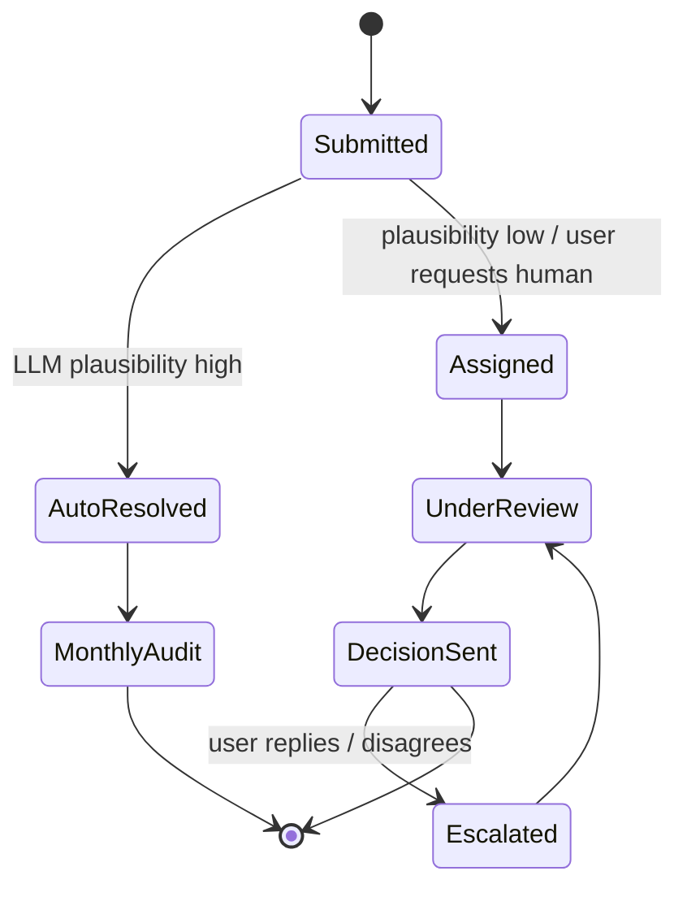
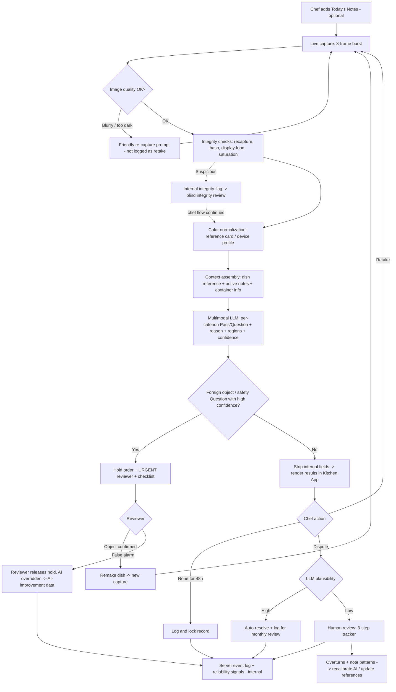

# Web PRD: WeBox AI Quality Cockpit

* **Document Owner:** Andrew Yuan (Product)
* **Engineering Lead:** TBD
* **Design Lead:** TBD
* **Status:** v1.0 (interview submission; matches the WeBox Kitchen and WeBox HQ prototypes)
* **Target Release / Milestone:** Pilot in Q1 2027 (proposed)
* **Prototypes:** WeBox Kitchen (chef app, server view, guided scenarios) and WeBox HQ (portal with Reviewer and Administrator sign-in) — Appendix B [links to add once shared]
* **Tracking Ticket / Epic:** [Epic link — TBD]

---

## 0. Author's Note: My Concerns, and What I Decided to Do Instead

Before the spec, I want to be upfront: I did not follow this brief to the letter, on purpose. I still cover every deliverable the brief asks for (see the mapping table in 0.4), but I changed what the system is *for*. Here's why.

### 0.1 The premise is flawed: one photo cannot judge a dish

The brief asks for a system that verifies a dish against a "Gold Standard" image, turns it into scores like Color Accuracy and Portion Volume, and ranks vendors so HQ can decide who to terminate. That assumes a photo can measure food quality. It can't.

* **A photo misses what makes food good.** Taste, seasoning, temperature, texture and doneness are all invisible to a camera. Temperature is also one of the biggest real food-safety factors, and a photo can't see it either.
* **The camera itself changes the answer.** iPhones tend toward duller, more realistic color. Many Chinese Android phones, like Xiaomi, boost saturation or apply an automatic "AI" enhancement. The same dish on two phones produces two different "color/freshness" results. That measures the phone, not the food. Lighting, angle, lens distortion and container depth make portion and color estimates unreliable in the same way.
* **The Gold Standard doesn't exist.** Say a chef is making ratatouille and the market has no good green bell peppers that day, so the chef uses red and yellow ones. The dish is arguably better, because the chef picked the best produce available. A visual-only system flags it immediately, punishing the chef for doing the job well. A chef's instinct for the right ingredient on the day is immediate and can't be modeled, no matter how sophisticated the system.
* **Sometimes the best dish is not a consistent one.** Produce changes with season, farm and weather. A good chef adapts. Penalizing variation penalizes the expertise we are paying for.
* **0–100 dish scores are false precision.** "Color Accuracy: 73" from one uncalibrated phone photo under kitchen lighting is a guess presented as data. It should not be the basis for ranking or terminating a partner.

**An image does not tell you the quality of the food. This PRD does not pretend otherwise.**

### 0.2 An AI judging chefs is disrespectful, and risky for the business

* Picture an older chef who has run a family restaurant for decades. Now a camera and an AI they didn't choose tell them their dish "failed" against a rubric they can't see. That is condescending, and it insults the independent partners who cook the food our clients actually eat.
* Our restaurant partners **are** our supply. Friction with them damages WeBox directly. The best kitchens have the most options and will leave first.
* Resentment also ruins the data: skipped photos, lazy angles, and people gaming the camera.

### 0.3 What I decided to do instead

1. **The chef-facing experience comes first.** There are only so many ways to present data on a dashboard. What makes this product work or fail is *how the data is gathered*, and whether that method respects the people providing it. So the kitchen app is the core of this PRD, and the HQ dashboard is built on top of it.
2. **Never accuse, always question.** The AI is a reference tool, not a judge. Every flag is a question, never a verdict, no matter the AI's confidence. Even at 100% confidence, a chef or manager can override the AI and trigger a human review.
3. **Context before judgment ("Today's Notes").** The chef tells the system what's different today *before* the AI looks, so the ratatouille case never raises a question in the first place.
4. **We judge the reliability of the vendor, not the goodness of the food.** It's not about how much data we collect, but *what* data. The AI's per-criterion photo results are **not** the key data. What gets weighted most in each vendor's final judgment is not the greenness of the broccoli, but:
   * **Positive customer reviews (40%)** — the people who actually taste the food.
   * **Honesty (40%)** — how the vendor behaves with our system.
   * **Photo check results (20%)** — the camera still rates color, portion and presentation, but only as a small share, because a photo is a weak signal of food quality.
5. **Cheating and lying are what we grade on.** If a vendor is caught trying to weasel through the program — uploading an image of fake or plastic food, a photo of a photo or screen, reused or filtered images — that is a **major deduction to their credibility score**. If a chef or manager lies about their food to trick the AI into no longer raising a question (a false dispute, a made-up substitution note), and it's caught, that is what counts. Smaller behavior patterns, like saying "it's fine" again on an issue a reviewer already confirmed without changing anything, cost a small automatic ding, once. A paler dish barely moves it.
6. **The tool is insurance, not surveillance.** Every photo is timestamped proof that the dish left the kitchen right. If a client complains, the photo protects the restaurant. That is why chefs will *want* to use it.
7. **The app never tells a partner they are good or bad.** It has no authority to. Any concern is raised by a human, through a separate email or conversation. Only small pattern dings (−2) are automatic; Major deductions need a person to verify them, and no termination or account action ever happens on automation alone.
8. **Food safety first, and optional while the AI learns.** The tool exists to catch hair, bugs and packaging bits before food leaves, and to protect partners with a record. Making it mandatory, and scoring honesty on day one, would feel like judging restaurant owners. So partners **opt in** during the pilot and can leave anytime. Partners who don't join keep working with WeBox as before, with no photo checks and no photo-based score.
9. **A photo pledge gives honesty scoring a fair footing.** Joining means ticking one promise: *"I pledge that every photo I take in WeBox Kitchen shows the exact food I am about to send out."* Honesty notes are measured only against that explicit promise, so a deduction is never a surprise rule. Honest mistakes and declared changes never count; the pledge is about not gaming the check.
10. **Two HQ roles, and blind review.** Reviewers handle safety holds, disputes and integrity notes, and never see a vendor's score, so every call is judged on the evidence, not the restaurant's reputation. Administrators see everything, including what each decision does to a partner's score, and are the only people who can change the rules.

### 0.4 How this PRD still covers every brief requirement

| Brief asks for | How this PRD delivers it |
| :--- | :--- |
| Centralized AI processing vs. "Standard Recipe" | Multimodal analysis against a **reference** (not a fixed standard), with chef context injected first (§6 F2, §7) |
| Automated scoring (Color, Portion, Presentation) | The kitchen sees per-criterion **Pass / Question** with plain-language reasons. The server stores a 0–100 check score and a confidence value per criterion, never shown to the kitchen, feeding only the 20% photo share (§6 F4, §7.3) |
| Supplier Performance Engine / vendor ranking | **Vendor Reliability Engine**: customer reviews (40%) + honesty (40%) + photo check results (20%) (§6 F11) |
| Dispute & Resolution workflow | Retake / Dispute, LLM plausibility check, 3-step human review tracker, override at any confidence (§6 F5–F6) |
| 30-day Quality Trends to inform termination | 30-day reliability trends; output is a "needs a conversation" list (total ≤ 60, or reviews or honesty below 10 of 40), not an auto-terminate list (§6 F10–F11) |
| JSON schema for rendering | Schema with a hard split between `chef_facing` and `internal` fields (§7.3) |
| Inspection Workspace: Ideal vs. Actual side-by-side with heatmaps/tags | Side-by-side reference vs. capture with "look here" region highlights — in the kitchen app and HQ (§6 F4, F10) |
| Command Center with Red/Green site health | Red / Amber / Green by open safety holds, integrity flags and reliability trends (§6 F10) |
| Case study: 5-minute safety resolution, false positives | §10 |

---

## 1. Problem & Executive Summary

* **Problem Statement:** WeBox serves hundreds of corporate dining sites through many restaurant and kitchen partners. HQ has little visibility into whether dishes leave kitchens complete, clean and safe, and no fair way to tell reliable partners from unreliable ones. Client complaints ("half-empty lunch," "hair in my food") are hard to verify after the fact, which hurts both clients and honest restaurants. *(Baseline complaint volume and resolution times to be pulled from WeBox support data.)*
* **Proposed Solution:** A two-sided web platform:
  * **WeBox Kitchen** (the Kitchen App, a mobile-first progressive web app) where chefs add context, capture a live photo, and get a respectful Pass / Question check on portion, color/freshness, foreign objects and presentation — with Retake, Dispute, and an always-visible help channel to an AI agent or a human.
  * **HQ Portal and server** (desktop web) with a Command Center, urgent safety queue, human review queue, an event log of everything the kitchen app sends, and a **Vendor Reliability Engine** that ranks partners mainly on customer reviews (40%) and honesty (40%), with photo check results as a smaller 20% share.
* **Target Audience / Roles:**

| Role | Surface | Needs |
| :--- | :--- | :--- |
| Kitchen Staff / Chef | Kitchen App (phone) | Fast capture, clear reasons, a way to explain context, never feel judged |
| Kitchen Manager / Owner | Kitchen App (phone/tablet) | Same as staff, plus their disputes, holds and record history. Chooses to join the pilot and signs the photo pledge |
| Site / Store Manager (client site) | Notifications + Kitchen App view | Fast alerts on safety holds and delivery delays |
| WeBox Reviewer (Quality) | HQ Portal | Safety, review and integrity queues with full photo context. No vendor scores or rules (blind review) |
| WeBox Administrator (HQ leadership, partner management) | HQ Portal | Everything: reliability trends, integrity decisions, references, AI Health, monthly reviews, audit log, criteria, thresholds, pilot enrollment, roles |

---

## 2. Goals & Success Metrics

Baselines marked "New" don't exist yet; the others should be pulled from WeBox data before launch.

| Metric | Baseline | Target (30 days post-pilot) | Tracking Mechanism |
| :--- | :--- | :--- | :--- |
| **Adoption:** Invited partners who opt in to the pilot | New | ≥ 60% of invited partners | `partner.onboarding_completed{pilot_opt_in}` / invites |
| **Primary (Leading):** Partner capture rate (orders with a capture) | New | ≥ 85% of pilot orders | `capture_completed` / orders, product analytics |
| **Primary (Trust):** Partner sentiment toward the tool | New | ≥ +30 NPS-style score | In-app 1-question survey, monthly |
| **Safety:** Median time to resolve an urgent safety hold | New | < 5 min (p90 < 8 min) | `safety_hold_opened` → `safety_hold_resolved` |
| **Fairness:** Dispute overturn rate (AI was wrong) | New | Tracked; trending down month over month | `dispute_resolved{outcome}` |
| **Fairness:** False question rate | New | < 15% of raised questions | Review outcomes |
| **Fairness:** Safety holds released by a reviewer as false alarms | New | Tracked per model version; trending down | `safety.hold_released{released_by=reviewer}` + `ai.improvement_data` |
| **Context:** Questions avoided by Today's Notes | New | ≥ 30% of would-be questions | Shadow comparison (with vs. without notes) |
| **Insurance value:** Client complaints resolved using photo evidence | TBD | ≥ 60% | Support ticket tag |
| **Supply health:** Pilot partner retention | TBD | No partner churn attributable to the tool | Partner management records |
| **Ops load:** Human review SLA adherence | New | ≥ 95% within SLA | Review queue timestamps |
| **Performance:** Capture → results shown | New | p90 ≤ 8s on mid-range Android, 4G | Real user monitoring |

---

## 3. Scope & Non-Goals

* **In Scope (MVP / Pilot):**
  * Kitchen App: opt-in onboarding with visible rubric and photo pledge, Today's Notes, live in-app capture, per-criterion Pass / Question results, Retake, Dispute, 3-step review tracker, safety hold flow, always-on help bubble, record history.
  * HQ Portal: role-based sign-in (Reviewer, Administrator), Command Center (operational view for reviewers, full view for administrators), urgent safety queue, review queue, inspection workspace, vendor reliability profiles with 30-day trends, integrity flag queue, reference library, AI health page, monthly review reports, audit log, settings with pilot enrollment.
  * Server event log and AI-improvement data pipeline (§6 F14).
  * Images only. English, Chinese and Spanish UI and input.
  * Integration with WeBox dispatch to hold orders on safety questions.
  * Customer review ingestion from WeBox's existing meal rating data.
* **Deferred to v1.1 / Out of Scope:**
  * Video capture and analysis.
  * Native iOS/Android apps (the PWA covers the pilot).
  * Client-facing "Chef's note" on meals.
  * Automated vendor penalties or termination of any kind (permanently out of scope).
  * Making the Kitchen App mandatory for all partners (only after the AI meets its accuracy targets and partners have been consulted).
  * Any taste, temperature or internal food-safety judgment from images (not possible; out of scope by design).

---

## 4. Information Architecture & Navigation Schema

### 4.1 Kitchen App (mobile-first PWA)

| Route / Path | Page / View Name | Access Gate | Breadcrumb / Parent |
| :--- | :--- | :--- | :--- |
| `/login` | Sign in (phone OTP or magic link) | Public | N/A |
| `/kitchen/welcome` | Onboarding (4 steps): what it does / doesn't do and that it's optional, insurance message, rubric, **photo pledge** | Kitchen Manager+ | First run only |
| `/kitchen/rubric` | Full rubric | Kitchen Staff+ | Home > Rubric |
| `/kitchen` | Home: today's orders and open items | Kitchen Staff+ | Home |
| `/kitchen/today` | Today's Notes | Kitchen Staff+ | Home > Today's Notes |
| `/kitchen/capture?order=:orderId` | Live capture | Kitchen Staff+ | Home > Order > Capture |
| `/kitchen/inspections/:id` | Results (per-criterion) | Kitchen Staff+ | Home > Order > Results |
| `/kitchen/inspections/:id/dispute` | Dispute form | Kitchen Staff+ | Results > Dispute |
| `/kitchen/disputes` | My disputes and trackers | Kitchen Staff+ | Home > Disputes |
| `/kitchen/disputes/:id` | Dispute tracker (3 steps) | Kitchen Staff+ | Disputes > Tracker |
| `/kitchen/holds/:id` | Safety hold | Kitchen Staff+ | Home > Hold |
| `/kitchen/records` | Record history (insurance archive) | Kitchen Manager+ | Home > Records |
| *(overlay)* `?help=open` | Help bubble chat | Kitchen Staff+ | Global, every route |

### 4.2 HQ Portal (desktop web)

| Route / Path | Page / View Name | Access Gate | Breadcrumb / Parent |
| :--- | :--- | :--- | :--- |
| `/hq/sign-in` | **Sign in** — company SSO in production; the prototype uses a demo account picker | Public | N/A |
| `/hq/command-center` | **Command Center** — Reviewer: holds, disputes and integrity notes, no scores. Admin: full partner health | Reviewer, Admin | HQ > Command Center |
| `/hq/safety-queue` | Urgent safety holds | Reviewer, Admin | HQ > Safety Queue |
| `/hq/review-queue` | Dispute review queue | Reviewer, Admin | HQ > Review Queue |
| `/hq/inspections/:id` | Inspection workspace (side-by-side). Reviewers see integrity signals and notes, never honesty points | Reviewer, Admin | Queue > Inspection |
| `/hq/vendors` | Vendor reliability ranking | Admin | HQ > Vendors |
| `/hq/vendors/:id` | Vendor profile, pilot and pledge status, 30-day trends | Admin | Vendors > Vendor |
| `/hq/integrity` | **Integrity flag queue** — suspected cheating captures awaiting a person's decision. Reviewers decide blind; administrators also see the score effect | Reviewer, Admin | HQ > Integrity |
| `/hq/references` | **Reference library** — every dish's reference photo the AI compares against | Admin | HQ > References |
| `/hq/references/:dishId` | **Dish reference detail** — one dish's reference, past versions, and chefs' notes | Admin | References > Dish |
| `/hq/ai-health` | **AI health & calibration** — how accurate the AI is, not the kitchens | Admin | HQ > AI Health |
| `/hq/reports/monthly/:vendorId/:yyyy-mm` | **Monthly vendor review** — AI summary: customer star ratings + integrity, 40/40/20 score | Admin | Vendor > Monthly |
| `/hq/audit-log` | **Audit log** — who viewed, decided or changed what, and why | Admin | HQ > Audit |
| `/hq/settings` | **Settings** — Reviewer: own account, what the role can open, rubric (read only). Admin: criteria, AI thresholds, dispute window, reliability rules, pilot enrollment, roles | Reviewer (account only), Admin | HQ > Settings |

**Role rule:** the menu shows only the pages a role can open, and every page checks the role on the server too. A reviewer who follows a link to an administrator page sees "This page is for administrators," never the data.

**Hard access rule:** Kitchen roles can never reach `/hq/*`. The API strips every `internal` field before responding to a kitchen-role token (§7.3), so reliability scores, confidence values and integrity flags cannot leak through the kitchen client, even by inspecting network traffic.

### 4.3 Deep Linking & Query Parameters

* HQ views keep filter state in the URL so links can be shared and survive refresh and back/forward:
  * `/hq/command-center?range=30d&region=south-bay&status=red`
  * `/hq/vendors?sort=reliability&range=30d`
  * `/hq/vendors/:id?tab=trends&range=30d`
  * `/hq/review-queue?status=assigned&priority=urgent`
* Kitchen App push notifications deep-link straight to the relevant item (`/kitchen/holds/:id`, `/kitchen/disputes/:id`).
* Help bubble state (`?help=open`) can be added to any route, so a support agent or reviewer can send a link that opens the chat.

---

## 5. Web-Specific Requirements

### A. Viewports & Responsive Breakpoints

* **Kitchen App — Mobile (sm, 360–767px), primary:**
  * Single column, sticky bottom action bar.
  * Minimum touch target 48×48px (larger than the usual 44px, because of wet or gloved hands).
  * Retake and Dispute buttons full-width, directly under each Question.
  * Help bubble fixed bottom-right, never covered by other UI. On the camera screen it moves to the top right so it never sits beside the shutter.
* **Kitchen App — Tablet (md, 768–1023px):** for manager stations; two-column layout (photo left, criteria right).
* **HQ Portal — Desktop (lg/xl, 1024px+), primary:**
  * Persistent sidebar navigation.
  * Side-by-side inspection workspace.
  * Maximum content width 1440px.
* **HQ Portal — Tablet:** read-only support, for checking the urgent queue away from a desk.

### B. Client-Side State, Session & Browser Storage

* **Offline-tolerant capture:**
  * Kitchens have bad Wi-Fi. Captures, notes and dispute drafts are queued in IndexedDB and uploaded when the connection returns.
  * The device capture time and the server receipt time are both recorded.
* **Drafts:** Today's Notes and dispute text are saved locally every 5 seconds, so nothing is lost on reload.
* **Auth:**
  * Session token in an `HttpOnly`, `Secure`, `SameSite=Lax` cookie.
  * Kitchen sessions last a full shift (12h), so staff aren't signed out mid-service.
  * Session expiry shows a re-auth prompt without losing queued captures.
* **Multi-tab sync:** BroadcastChannel keeps HQ queue counts and sign-out consistent across tabs.
* **Real-time updates:**
  * The dispute tracker and safety holds update over Server-Sent Events.
  * Web Push notifies on each tracker step change. On iOS, Web Push requires the PWA to be added to the Home Screen, which onboarding walks the user through.
  * SMS is the fallback for urgent safety holds.

### C. Web Performance & Core Web Vitals

* **LCP:** ≤ 2.0s on a mid-range Android over 4G (Kitchen App); ≤ 1.5s on desktop (HQ).
* **INP:** ≤ 200ms. The camera shutter and Retake/Dispute taps must feel instant.
* **CLS:** ≤ 0.05. Results cards reserve their height while analysis streams in.
* **Capture → results:** p90 ≤ 8s, with progressive per-criterion rendering as each result arrives.
* **Bundle budget:** Kitchen App initial JS < 150 KB compressed. Images uploaded as compressed JPEG or WebP at ≤ 2048px on the long edge.

### D. Camera Capture & Integrity (web-specific)

* **Live capture only** through `getUserMedia`. There is no `<input type="file">` and no gallery upload, which blocks filtered, edited or recycled images.
* **Multi-frame burst:** 3 frames over ~300ms. Used to detect photos of screens or prints (moiré, glare, flat parallax) and to pick the sharpest frame.
* **Framing overlay:** shows the container outline and a target angle and height, reducing portion error from angle and lens.
* **Color reference card (optional, recommended):**
  * A printed card WeBox ships to each partner.
  * When detected in frame, it is used for color normalization across phones and lighting, which addresses the iPhone vs. Xiaomi problem.
* **Device context:** device model is recorded from User-Agent Client Hints where available. When color can't be normalized, the AI is instructed to treat color as low-certainty and lean toward Pass.
* **Camera permission denied:** show a plain-language guide for enabling it, plus a help bubble shortcut. Never a dead end.

### E. SEO & Metadata

* Not applicable. The whole product sits behind auth, and every route is `noindex, nofollow`. No OpenGraph previews, because deep links must not leak dish photos into chat-app previews.

### F. Accessibility & Language (a11y / i18n)

* **WCAG 2.1 AA.**
* High-contrast mode for bright kitchen lighting.
* Pass / Question never rely on color alone: always icon plus text ("✓ Pass", "? Question").
* `aria-live="polite"` for streaming results and tracker updates.
* **Languages:** English, Chinese (Simplified and Traditional) and Spanish for UI, notes, disputes and the help agent. Free text in any language is translated for the AI and reviewers, and the original is always kept.
* **Voice input** for Today's Notes and disputes, for busy hands.
* **Plain-language copy rules** (enforced in content review):
  * Banned in kitchen-facing copy: fail, wrong, error, violation, reject, score, grade, poor, bad.
  * Explanations of how the system works appear only in onboarding. Every other screen uses short, functional text, with no lines that justify or describe the system.

### H. Visual Design (brand)

* **Kitchen App — single light theme, on purpose:** white background with the WeBox red accent, matching WeBox's brand. White is also the easiest to read in bright kitchens.
* **HQ Portal — single dark theme, on purpose:** an office tool people watch for hours, so a low-glare dark palette is easier on the eyes. Status colors (red / amber / green, blue for "in review") always come with a text label or icon.
* **Color roles:** red for brand actions (primary buttons, active tab, Help bubble) and for urgent safety. Pass is green, Question is amber, review progress is blue. Red never marks an ordinary Question.
* **Motion:** only the safety hold flashes (banner, order chip, pulsing outline around the possible object). Nothing else blinks. All motion is disabled under `prefers-reduced-motion`.

### G. Security & Privacy

* Photos are encrypted at rest and accessible only to the owning partner, assigned reviewers and HQ roles.
* Faces or people captured in the background are blurred server-side before storage.
* Every access to an inspection, and every change to a reliability score, is written to the audit log with the signed-in person's name.
* **Role-based access** is enforced server-side (Reviewer, Administrator). Reviewer responses never include reliability scores, honesty points or the score effect of a decision.
* **Retention:** inspection records kept for 13 months, to support complaint handling and year-over-year trends (to be confirmed with legal).

---

## 6. Functional Specifications & Acceptance Criteria

### Feature 1: Onboarding & Visible Rubric

* **User Story:** As a chef using this for the first time, I want to know exactly what this tool checks and what it doesn't, so I don't feel judged by a black box.
* **UI/UX Behaviors:**
  * The first screen opens with **"Welcome to WeBox Kitchen,"** a food-safety photo check, and says it is **optional during the pilot**: join if it helps, leave anytime from Help.
  * It then states what the tool **does**, food safety first:
    * Looks for possible hair, bugs or packaging bits before food leaves.
    * Checks color/freshness, portion and presentation.
    * Creates a timestamped record that protects you.
  * It also states what the tool **does not** do:
    * Grade you or your cooking.
    * Judge taste, seasoning or skill.
    * Make final decisions — people do.
  * The full rubric is shown before the first capture and stays one tap away from every results screen. Each criterion lists only what it **looks at** and when it **asks a question**.
  * Disclosure: *"WeBox tracks overall reliability trends across partners. Individual photos are never used to grade your cooking."*
  * The insurance message comes first: *"Every photo is proof your dish left your kitchen right."*
  * **Photo pledge (last step):** *"One promise before you start."* A checkbox reads *"I pledge that every photo I take in WeBox Kitchen shows the exact food I am about to send out,"* with three plain lines on what it means: photos are live and of the dish going out; no screens, printouts, display food or earlier photos; something different today goes in a Today's Note, and honest notes never count against you. **"I pledge · Start service" stays disabled until the box is ticked.**
  * The pledge is saved with the date, version and signer (`chef.pledge_signed`). It is the standing ground for the honesty score (§6 F11): we only measure honesty against a promise the partner explicitly made.
* **Acceptance Criteria:**
  * `Given` a kitchen user signing in for the first time
  * `When` they land on `/kitchen`
  * `Then` they are redirected to `/kitchen/welcome`, must view the rubric before their first capture, and can reach `/kitchen/rubric` from every results screen.
  * `Given` the pledge step
  * `When` the box is not ticked
  * `Then` "Start service" is disabled; ticking it enables the button, and completing it logs `chef.pledge_signed` with a timestamp and version `v1`.

### Feature 2: Today's Notes (context before judgment)

* **User Story:** As a chef, I want to tell the system what's different today before it looks at my dish, so it doesn't question choices I made on purpose.
* **UI/UX Behaviors:**
  * **Quick chips** for common changes:
    * Ingredient substitution
    * Seasonal variation
    * Different container
    * Portion adjusted per client
    * Garnish change
    * Special item
    * Lighting or camera changed
  * **Structured substitution** entry: *from* → *to*, reason, and duration (today only / this week / until a set date).
  * Free text and voice note, in any supported language.
  * Persistent notes appear as an "Active notes" banner on the home screen and attach to every matching order until they expire.
  * Notes are optional. They are never required to capture.
* **AI behavior:** Active notes are injected into the analysis context. The AI compares the photo against the reference *as adjusted by the notes*.
* **Downstream value:**
  * HQ sees substitution patterns per dish in `/hq/references/:dishId`. When many partners note the same change, HQ updates the reference with the chef, so the standard becomes living, not fixed.
  * Proactive, honest notes count toward reliability (§6 F11).
* **Acceptance Criteria:**
  * `Given` a chef has an active note "green bell pepper → red/yellow bell pepper, today only" for Ratatouille
  * `When` they capture a Ratatouille with red and yellow peppers
  * `Then` Color & Freshness shows **✓ Pass** with a reason that mentions the note, and no question is raised about the peppers.
* **Edge Cases:**
  * A note contradicts the photo (e.g., note says "smaller container" but the container matches the reference). The AI may still raise a Question, worded neutrally. The contradiction is logged internally for the monthly review. It is **not** treated as a lie unless a human confirms it.

### Feature 3: Live Capture

* **User Story:** As kitchen staff, I want capturing a dish to take seconds, so it doesn't slow down service.
* **UI/UX Behaviors:**
  * Opening a capture starts the live camera with the framing overlay.
  * One shutter tap triggers the 3-frame burst.
  * If the image is blurry or too dark, a friendly prompt asks for a quick retake. This is a camera issue, not a Question, and it is not logged as a retake.
* **Acceptance Criteria:**
  * `Given` a user on `/kitchen/capture?order=123`
  * `When` they tap the shutter
  * `Then` the captured frame is shown within 500ms and per-criterion results begin streaming within 8s (p90).
* **Edge Cases:**
  * Offline: show "Saved — will upload when you're back online," and let the user continue to the next order.
  * Camera unavailable: show the permission guide and the help bubble. Never a dead end.

### Feature 4: Results — Per-Criterion Pass / Question

* **User Story:** As a chef, I want to see what the AI noticed and why, in plain words, without a grade.
* **UI/UX Behaviors:**
  * **Side-by-side view:** reference image vs. captured image. On mobile it's a swipe toggle; on tablet and desktop, two panes.
  * Region highlights mark "look here" areas, not red "error" heatmaps.
  * **One expandable section per criterion:**
    1. **Portion**
    2. **Color & Freshness**
    3. **Foreign Objects**
    4. **Presentation & Plating**
    5. **Components** (proposed): expected items present, including declared substitutions.
    6. **Packaging & Label** (proposed): seal, label and allergen tag. Also explains portion differences caused by a different box.
  * Each section shows **✓ Pass** or **? Question** and a 1–3 sentence reason.
  * **There is no overall grade, number or color-coded score in the kitchen app.**
  * **Server side only:** each criterion also gets a 0–100 check score and a confidence value. They are stored on the server (§7.3) and never sent to kitchen roles. They feed the 20% photo share of the reliability score and the AI health metrics.
  * **Gentle honesty question:** when integrity checks suspect a photo of a screen or display food (§6 F12), the results look normal, plus one line at the bottom: *"Does this photo show the dish exactly as it's going out today?"* with **Yes, it does** / **Retake photo**. No warning, no accusation. The answer is attached to the integrity note for the reviewer, alongside the partner's photo pledge.
  * Question copy is always phrased as a question:

| Never | Always |
| :--- | :--- |
| "Portion too small. Fail." | "This looks smaller than the reference. Is this the same container we're comparing against?" |
| "Color mismatch." | "The peppers look red and yellow instead of green. Was there a substitution today?" |
| "Presentation score: 62." | "The garnish looks different from the reference. Is this an intentional change?" |

* **Acceptance Criteria:**
  * `Given` any inspection result
  * `When` it renders in the Kitchen App
  * `Then` no numeric score, confidence value or grade is present in the DOM or in the API response.
  * Each Question section shows **Retake** and **Dispute** buttons directly beneath its reason.

### Feature 5: Retake

* **User Story:** As a chef, when the AI catches something I can fix, I want to fix it and try again without being penalized or made to feel bad.
* **UI/UX Behaviors:**
  * The button reads **"Retake photo."** Supporting text: "Fix it up and try again."
  * The new result replaces the view.
  * On Today's orders, a small retake count (↻ 2) sits beside each order's status, so the kitchen can see how many tries a dish took.
  * The results screen itself shows no counter or "attempt 3 of 5" label, and the tone never changes.
* **Behind the scenes:**
  * Each retake is linked in a chain (original → retake 1 → retake 2…).
  * The backend compares frames in the chain:
    * **Same dish, fixed** (portion topped up, hair removed): normal, no concern.
    * **Substantially different image** (different dish, plate or staging, or a big saturation jump): logged as a reliability signal for human review.
  * Patterns feed the honesty component as small automatic dings, once per pattern per order (§6 F11): needing 4+ photos to pass, retaking the same dish twice with nothing changed, or 3+ retakes with no note or dispute explaining what changed. They never change anything the chef sees.
* **Acceptance Criteria:**
  * `Given` an inspection with a Question
  * `When` the user taps Retake and captures again
  * `Then` the new result is shown with the same layout and tone, and `retake_chain_position` increments only in internal data.

### Feature 6: Dispute & 3-Step Review Tracker

* **User Story:** As a chef or manager, I want to say "I disagree, here's why" on any result and always know what's happening with it.
* **UI/UX Behaviors:**
  * **Dispute is available on every criterion result**, including Passes and including results where the AI was 100% confident.
  * Reasons to pick from: Ingredient substitution, Different container, Lighting or camera, It's fine as is, Something else. Plus text or voice in any supported language, an optional extra photo (live capture), and "I'd like a person to look at this."
  * After a decision where the question stands, the chef can **Retake** or **Dispute again**.
  * **LLM plausibility check:**
    * **High plausibility** (e.g., declared container change, substitution, lighting): resolved immediately. The user sees "Thanks, noted. The question is resolved," with an offer to save the explanation as a Today's Note. The case is logged for the monthly review.
    * **Low plausibility, or the user asks for a person:** goes to human review.
  * **3-step tracker,** always visible at `/kitchen/disputes/:id`:
    1. **Assigned to a reviewer** — "Expected wait: ~X min."
    2. **Under review** — "A reviewer is looking at it now. Expected decision: ~X min."
    3. **Decision sent** — the outcome, the reviewer's explanation, and options to reply or escalate.
  * Each step shows status, expected time and what happens next. Web Push fires on every step change. **The user is never left in the dark.**
* **Dispute state machine:**



* **Acceptance Criteria:**
  * `Given` a Question result
  * `When` the user submits a dispute that the LLM rates low-plausibility
  * `Then` the tracker shows Step 1 with an expected wait within 2 seconds, and a reviewer is assigned within the SLA (standard: 2 business hours; urgent: 2 minutes).
* **Edge Cases:**
  * Reviewer SLA missed: the case auto-escalates to a supervisor, and the user sees an updated time estimate and an apology. The wait is never silent.
  * Dispute on a Pass (e.g., the chef thinks the AI missed something): routed to review as an AI-quality report and thanked publicly in the tracker.
  * **"It's fine" without changing anything:** the first "It's fine as is" claim is just logged. A second claim on the same issue, after a reviewer has already confirmed it and with the photo unchanged, costs a Minor honesty ding (−2). Further repeats are logged but **never stack**.

### Feature 7: Safety Hold (possible foreign object or food safety risk)

* **User Story:** As a chef, if there might be a hair or bug in a dish, I want to know immediately and get help, so nothing unsafe goes out.
* **Principle:** the wording stays a question, but the urgency is real. A dish with a possible hair or bug is never "picked clean and sent." It is set aside and remade, and the kitchen checks its prep area.
* **UI/UX Behaviors:**
  * When the foreign-object question is high-confidence:
    * A flashing red **"Stop · Hold this order"** banner, an urgent push notification, and a pulsing red outline around the possible object.
    * Message: *"There may be a hair on the rice, right next to the chicken. Please don't send this dish out."*
    * The order is placed **on hold** through the dispatch integration and can't be picked up until resolved.
    * The case goes to the HQ urgent queue as **URGENT**, and a reviewer joins the hold screen within seconds.
  * **Checklist** (tap to tick):
    1. Set this dish aside. Don't pick it out and send it.
    2. Check the rest of this batch.
    3. Check your prep area: hair restraints, surfaces, utensils and nearby containers.
    4. Remake the dish.
  * **Actions:**
    * **"Remade the dish · take new photo"** (primary).
    * **"Talk to a person now."**
    * A small **"I think this is a mistake"** link, which sends the case to the reviewer. There is no option for the chef to release the hold themselves.
  * A visible timer runs for both the chef and the reviewer. At 4 minutes the case escalates to a supervisor, and the client site manager is told pickup may run late.
* **How a hold ends:**
  * **Remake:** the new photo passes, the hold is released, and the order returns to the pickup queue.
  * **Reviewer clears it (false alarm):** the reviewer looks at the photo, finds no foreign object (e.g., a drizzle of sauce), and releases the hold, overriding the AI. The chef sees "Hold released by WeBox Quality." The case goes to the AI-improvement dataset (§6 F14) and never counts against the kitchen.
* **Acceptance Criteria:**
  * `Given` an inspection where `foreign_objects` is a Question with internal confidence ≥ the hold threshold
  * `When` the result is produced
  * `Then` the order status becomes `held` within 2s, an urgent reviewer is paged, and the chef sees the flashing hold screen with the checklist, "Remade the dish," "Talk to a person now," and no self-release option.
  * `Given` a reviewer marks the hold as a false alarm
  * `Then` the hold is released, the foreign-object result shows as cleared by WeBox Quality, an `ai.improvement_data` event is sent, and the honesty score is unchanged.
* **Edge Cases:**
  * Low-confidence foreign-object question: no automatic hold. It shows as a normal Question with a strong suggestion to check.
  * The remade photo still shows a possible object: the hold stays on and the reviewer asks for another remake.
  * Reviewer unreachable: SMS fallback to the on-call supervisor.

### Feature 8: Always-On Help Bubble

* **User Story:** As anyone using the Kitchen App, I want to ask a question or raise a problem at any moment and reach someone who can answer, AI or human.
* **UI/UX Behaviors:**
  * A floating bubble on **every** route. It is never hidden in a menu, never covered by modals, and never removed.
  * It opens an LLM support agent that can:
    * explain any result and why a question was raised
    * explain the rubric
    * help with the camera, notes and disputes
    * reply in the user's language
  * A **"Talk to a person"** button is always visible inside the chat, not only after the AI fails.
  * The agent auto-escalates when the question is out of its depth, the user seems frustrated, or a safety topic comes up.
  * The chat keeps the current screen's context (inspection ID, order ID), so the user doesn't have to explain where they are.
  * Typed messages show as "Sent." The assistant replies right away; once a person has joined, Maria or another WeBox Quality team member replies as soon as they're online, and the chat says so.
* **Acceptance Criteria:**
  * `Given` any Kitchen App route, including modals and the capture screen
  * `When` the page renders
  * `Then` the help bubble is visible, focusable and tappable, and "Talk to a person" is reachable in ≤ 2 taps.

### Feature 9: Dispute Window & Lock-In

* **UI/UX Behaviors:**
  * Every result has a dispute window (default 48h, configurable).
  * If nothing is raised or flagged within the window, the record is **logged and locked**.
  * Locked records appear in `/kitchen/records` as insurance evidence ("proof it left right"), with timestamp, photo and notes.
* **Acceptance Criteria:**
  * `Given` an inspection with no dispute and no open question after 48h
  * `When` the window closes
  * `Then` the record status becomes `locked`, and it can be exported as evidence for a client complaint.

### Feature 10: HQ Command Center & Inspection Workspace

* **User Story:** As HQ, I want to see at a glance which sites and partners need attention right now, and why.
* **Two views, by role:**
  * **Reviewer (operational only):** cards for open holds, disputes in review (and how many are assigned to me), integrity notes to review and overdue reviews; partner activity tiles marked Safety hold / Review overdue / In review (a dispute or integrity note) / All clear, each linking to the item; live urgent queue and review queue. **No reliability scores, conversation list or reference health**, so reviews stay blind.
  * **Administrator (full):** everything below.
* **UI/UX Behaviors (Administrator view):**
  * **Site/partner health grid** (Red / Amber / Green):
    * **Red:** open urgent safety hold, a Major integrity note waiting for review, or a partner that needs a conversation (§6 F11 thresholds).
    * **Amber:** overdue reviews, rising retake or dispute rates, a declining reliability trend, or a total below 80.
    * **Green:** normal.
  * **Live urgent queue** with countdown timers.
  * **Review queue** with SLA status.
  * **Inspection workspace** (`/hq/inspections/:id`):
    * Reference vs. capture side-by-side, with region overlays.
    * The full retake chain.
    * Today's Notes.
    * The dispute text, in the original language and translated.
    * Internal AI confidence.
    * Reviewer actions: uphold / overturn / partial, with a required written reason that the chef will see.
    * Integrity signals and the integrity note are shown to both roles. Honesty points and score effects are shown to administrators only.
  * **Reference health:** dishes where many partners raise the same question or note the same substitution — a sign the reference is outdated, not the kitchens.
* **Acceptance Criteria:**
  * `Given` HQ staff on `/hq/command-center`
  * `When` a new safety hold opens anywhere
  * `Then` the affected site tile turns Red and the urgent queue count updates within 5s without a page refresh.
  * `Given` a Reviewer on `/hq/command-center`
  * `Then` no reliability score, honesty value, conversation list or reference health appears anywhere on the page or in its API response.

### Feature 11: Vendor Reliability Engine (replaces "Supplier Performance Engine")

* **User Story:** As partner management, I want a fair, defensible view of which vendors are reliable and honest, so I know which relationships need a conversation.
* **Scope:** only partners who opted in to the pilot and signed the photo pledge (§6 F1). Partners who haven't joined are never scored on photos or honesty.
* **Principle:** We judge the **reliability of the vendor** first, and the goodness of the food only lightly. The camera still rates the food, but per-criterion photo results (color, portion, presentation) are capped at a **small 20% share**, because one photo is a weak signal of quality.
* **Vendor Reliability Score (internal only, never shown in the Kitchen App):**

| Component | Weight | Inputs |
| :--- | :--- | :--- |
| **Customer reviews** | 40% | Diner ratings and comments per dish, from WeBox's meal rating data. The people who taste the food. |
| **Honesty** | 40% | Starts at full credit. **Major deductions** for confirmed cheating or lying (below). Also reflects retake-chain patterns, dispute believability and how the vendor responds to safety holds. Proactive Today's Notes use is a **positive** signal. |
| **Photo check results** | 20% | Share of criteria passed on color & freshness, portion, presentation and foreign objects, over the period. Counted only from **final** results: after the dispute window locks or a review decides. Overturned questions and declared substitutions are excluded. |

* **Honesty deductions.** Two tiers:
  * **Major (−10):** applied **only after a WeBox reviewer or administrator verifies** the integrity note. Each note shows the partner's photo pledge (date and signer), because a Major deduction means a photo broke that promise.
  * **Blind integrity review:** reviewers see the photo, the reference, the detection evidence, the chef's answer and the pledge. They never see the partner's score or what their decision will do to it, so the question stays "is this the real dish?", not "is this a good partner?" Administrators can also decide, and see the score effect first.
  * **Minor (−2):** behavior patterns, applied **automatically**, **at most once per pattern per order**. Repeats are logged as "already counted" and never stack.

| Behavior | Tier | When it applies |
| :--- | :--- | :--- |
| Image of fake / plastic / display food | Major | A person verifies |
| Photo of a photo or a screen | Major | A person verifies |
| Reused or duplicated image from an earlier order | Major | A person verifies |
| Edited or filtered image, or tampered capture | Major | A person verifies |
| Lying to trick the AI into dropping a question (false dispute, fabricated substitution note) | Major | A person verifies |
| Said "it's fine" again without changing anything (2nd claim on an issue a reviewer already confirmed) | Minor | Automatic, once |
| Kept resubmitting the same dish without changing anything (2+ unchanged retakes) | Minor | Automatic, once |
| Retake that swaps in a different or staged-looking photo | Minor | Automatic, once |
| Needing 4+ photos to pass in one chain | Minor | Automatic, once |
| 3+ retakes with no note or dispute explaining what changed | Minor | Automatic, once |
| Today's Notes that repeatedly don't match the dish (e.g., "different container" with no change) | Minor | Automatic, once |

* **Chef's answer to the gentle honesty question** (§6 F4) is attached to the integrity note. If a reviewer verifies the photo wasn't the real dish after the chef answered "Yes," that is treated as lying to the check, against the pledge.
* **Dismissed notes** cost nothing and are sent to retrain the detector.
* **What can only nudge the score a little:** a dish that looks a little less colorful or a little smaller. It touches only the 20% photo share.
* **What never lowers the score:**
  * An honest, declared substitution
  * A different phone's camera
  * A question the AI raised that turned out to be wrong
  * An upheld dispute
* **Views:**
  * `/hq/vendors` ranking by reliability with 30-day sparklines.
  * `/hq/vendors/:id` 30-day trends: customer sentiment, honesty events, retake rate, dispute rate and outcomes, notes usage, safety response time, reviewer hours.
* **Standing thresholds** (adjustable in `/hq/settings`, every change logged):

| Standing | Rule | What happens |
| :--- | :--- | :--- |
| **Needs a conversation** (Red) | Total score **≤ 60** | **Automatic review call request**, assigned to the partner manager |
| **Needs a conversation** (Red) | Customer reviews **or** honesty **below 10 of 40**, whatever the total | Conversation request. A perfect score elsewhere can't hide a broken component. |
| **Watch** (Amber) | Total **below 80**, or a declining trend (rating down, retakes rising) | Shown on Command Center; no request |
| **Healthy** (Green) | Everything else | Nothing |

* **Decision support, not decision making:**
  * Vendors at Red appear on a **"Needs a conversation"** list with the reason (e.g., "Honesty 8 / 40, below the floor of 10").
  * Requests move Requested → Scheduled → Held, with an internal call log.
  * Any concern is communicated by a human, through a separate email or meeting with partner management, **never through the app**.
  * No automated penalties or termination.
* **Acceptance Criteria:**
  * `Given` vendor V with 4.8★ reviews and a 98% photo pass rate
  * `When` a reviewer verifies a Major note that takes honesty below 10
  * `Then` V moves to "Needs a conversation" and a conversation request is created, even though the total is above 60.
  * `Given` an integrity flag on vendor V
  * `When` a reviewer verifies it in `/hq/integrity`
  * `Then` the honesty deduction is applied and recorded in the audit log with the reviewer's name, the reviewer sees no score change, and nothing changes in vendor V's Kitchen App.
  * `Given` a Reviewer account on `/hq/integrity`
  * `Then` the page shows the evidence with Verify / Dismiss, and no honesty value, score preview or standing.
  * `Given` an integrity flag that a reviewer dismisses
  * `Then` no deduction is applied and the case is used to recalibrate the detector.
  * `Given` a chef has already received the Minor ding for saying "it's fine" on an issue
  * `When` they say "it's fine" again on the same unchanged issue, or the scenario repeats
  * `Then` no further deduction is applied, and an `integrity.pattern_repeat` event is logged.

### Feature 12: Integrity Detection

* **Signals checked on every capture (internal only):**
  * Screen or print recapture (moiré, glare, flat parallax across burst frames).
  * Perceptual-hash match against the vendor's and all vendors' past images.
  * Display or plastic food indicators (unnatural specular highlights, zero variation across days).
  * Abnormal saturation jumps within a retake chain.
  * "Too perfect" patterns: near-identical images day after day, which real cooking doesn't produce.
* **Behavior:** a detection creates a Major integrity note for human review. **The chef flow continues normally.** The only visible change is the gentle honesty question at the bottom of the results (§6 F4). Major notes are never confirmed automatically; a reviewer (or administrator) verifies or dismisses each one.

### Feature 13: Monthly Vendor Review

* A fully AI-generated monthly summary per vendor. No human sign-off on the summary itself.
* **It is not a summary of how the AI judged individual dishes.** It summarizes the vendor's reliability, following the 40/40/20 score:
  * **Customer reviews (40%):** star ratings and comments from diners over the month.
  * **Integrity (40%):** confirmed integrity flags, dispute believability (including disputes that were auto-resolved), retake patterns and Today's Notes use.
  * **Photo check results (20%):** a one-line pass-rate figure only, no dish-by-dish breakdown.
* It lists the partner's photo pledge date and signer.
* Major deductions inside it come only from notes a person already verified (§6 F11), so the summary never introduces an unconfirmed accusation. Minor pattern dings are listed as applied automatically, with the behavior that triggered each.

### Feature 14: Server Event Log & AI-Improvement Data

* **User Story:** As WeBox HQ, I want a record of everything the kitchen app sends, so every score, ding and decision can be traced, and every AI mistake improves the model.
* **What the server receives** (never shown in the kitchen app):

| Event | Sent when | Key data |
| :--- | :--- | :--- |
| `inspection.received` | Every analyzed photo | What the chef sees per criterion, internal 0–100 scores, AI confidence, device, color correction, integrity checks, retake chain |
| `capture.retry_requested` | Photo too dark or blurry | Reason; not counted as a retake, no scores recorded |
| `note.created` / `note.removed` | Today's Notes | Type, from → to, duration; a positive honesty signal |
| `chef.pledge_signed` | Photo pledge ticked at the end of onboarding | Signer, pledge version and text, timestamp, pilot opt-in |
| `partner.onboarding_completed` | Partner joined the pilot | Pilot opt-in, rubric and disclosure shown, pledge signed |
| `integrity.note` | Major detection or Minor pattern | Severity, evidence, status (waiting for review / applied), pledge date |
| `integrity.pattern_repeat` | A Minor pattern repeats | Points: 0, "already counted" |
| `integrity.reviewed` | A reviewer or administrator verifies or dismisses a Major note | Decision, who decided and their role, chef's honesty-question answer, pledge date |
| `reliability.updated` | Any score change | Change, reason, new 40/40/20 breakdown |
| `chef.claim_its_fine` | "It's fine as is" dispute | Claim number, whether a reviewer already confirmed the issue |
| `chef.attestation` | Answer to the gentle honesty question | Yes / retake |
| `dispute.received` / `dispute.review_step` / `dispute.auto_resolved` / `dispute.decided` | Dispute lifecycle | LLM plausibility and reasoning, route, outcome |
| `safety.hold_opened` / `safety.reviewer_joined` / `safety.checklist` / `safety.hold_escalated` / `safety.hold_released` | Safety hold lifecycle | Timing, who released it, whether the AI was overridden |
| `ai.improvement_data` | The AI was wrong | Dataset, what the model said, the human label, image region |
| `help.message` / `help.escalated` | Help chat | Mode, context inspection |
| `record.shared` | A record is copied as evidence | Record ID |
| `auth.signed_in` | Someone signs in to the HQ Portal | User, role |

* **AI-improvement datasets**, sent to HQ › AI Health:
  * `foreign_object_false_positives`: safety holds a reviewer released as false alarms.
  * `overturned_questions`: disputes where the reviewer agreed with the chef.
  * `chef_reported_misses`: disputes on a Pass, where the chef thinks the AI missed something.
  * `integrity_false_positives`: Major integrity notes a reviewer dismissed.
* **Acceptance Criteria:**
  * `Given` any kitchen action listed above
  * `When` it completes
  * `Then` the matching event is written within 2s, appears in the HQ event log, and none of its internal fields reach a kitchen-role client.

---

## 7. AI & Algorithmic Logic Flow

### 7.1 Inspection pipeline



### 7.2 Model guardrails

* **Question-only output:** the model never emits verdict language. A post-processing filter rejects and regenerates any `chef_message` containing banned words.
* **Uncertainty leans toward Pass:** when color can't be normalized or the image angle is poor, color and portion lean toward Pass. Foreign objects are the one exception, where uncertainty leans toward asking (with a low-confidence nudge, not a hold).
* **Notes override the reference:** declared substitutions and container changes take precedence over the reference image.
* **No grading language in the kitchen, ever:** the model also returns a 0–100 check score per criterion, but it is stored internally only and feeds the 20% photo share. Confidence is used for routing.
* **Timeout fallback:** if analysis takes more than 15s, the capture is saved as a record ("Saved — no check this time"). The order is not blocked and nothing is assumed against the kitchen. Capture integrity checks still run asynchronously.
* **Model and prompt version** are stored with every result, so overturn rates can be tracked per version.

### 7.3 Output schema (rendering contract)

The server returns `chef_facing` fields only to kitchen roles. `internal` exists only in HQ responses and storage.

```json
{
  "inspection_id": "insp_000123",
  "order_id": "ord_4567",
  "vendor_id": "vend_089",
  "dish_id": "ratatouille_v2",
  "captured_at": "2026-10-28T11:42:05-07:00",
  "retake_of": null,
  "notes_applied": [
    { "type": "substitution", "from": "green bell pepper", "to": "red/yellow bell pepper", "reason": "market availability", "expires": "2026-10-28" }
  ],
  "chef_facing": {
    "criteria": [
      {
        "criterion": "portion",
        "status": "question",
        "message": "This looks smaller than the reference. Is this the same container we're comparing against?",
        "regions": [{ "x": 0.10, "y": 0.20, "w": 0.60, "h": 0.50, "label": "fill level" }],
        "actions": ["retake", "dispute"]
      },
      {
        "criterion": "color_freshness",
        "status": "pass",
        "message": "Peppers match today's note (red and yellow). Vegetables look fresh.",
        "regions": [],
        "actions": ["dispute"]
      },
      {
        "criterion": "foreign_objects",
        "status": "pass",
        "message": "Nothing unusual spotted.",
        "regions": [],
        "actions": ["dispute"]
      },
      {
        "criterion": "presentation",
        "status": "pass",
        "message": "Arranged as expected.",
        "regions": [],
        "actions": ["dispute"]
      },
      {
        "criterion": "components",
        "status": "pass",
        "message": "All components are here, including today's pepper swap.",
        "regions": [],
        "actions": ["dispute"]
      }
    ],
    "honesty_question": null,
    "safety_hold": false,
    "dispute_window_closes_at": "2026-10-30T11:42:05-07:00"
  },
  "internal": {
    "scores": { "portion": 61, "color_freshness": 90, "foreign_objects": 97, "presentation": 89, "components": 94 },
    "confidence": { "portion": 0.71, "color_freshness": 0.88, "foreign_objects": 0.95, "presentation": 0.83, "components": 0.92 },
    "device": { "model": "Xiaomi 14", "color_normalized": true, "method": "reference_card" },
    "integrity": {
      "recapture_suspected": false,
      "duplicate_hash_match": null,
      "display_food_suspected": false,
      "saturation_jump_in_chain": false
    },
    "retake_chain_position": 0,
    "routing": "show_to_chef",
    "model_version": "qc-mm-2026.10",
    "prompt_version": "qc-prompt-v7"
  }
}
```

**Rendering rules:**
* The client renders only `chef_facing`.
* `status` is an enum: `pass` | `question`. There is no `fail` value in the schema.
* `actions` decides which buttons appear. `dispute` is always present.
* `honesty_question` is `null`, or the gentle question text when a Major integrity check fired (§6 F4).
* `internal.scores` and `internal.confidence` are never sent to kitchen roles.

---

## 8. Release Strategy & Rollout Plan

* **Phase 0 — Internal dogfooding (2 weeks):** WeBox's own commercial kitchen space and staff. Tune the wording, timing and offline behavior.
* **Phase 1 — Shadow mode with pilot partners (2–4 weeks):**
  * 5–10 volunteer partners who **opt in** and sign the photo pledge, ideally including at least one long-running family restaurant. No partner is required to join.
  * Captures and results only. **No holds (except confirmed safety issues), no reliability scoring.**
  * Weekly calls with pilot chefs to review wording and disputes.
* **Phase 2 — Safety holds on:** for pilot partners, once the false-hold rate is acceptable.
* **Phase 3 — Reliability engine visible to HQ:** only after customer sentiment ingestion and integrity review are working, and after partners have been told what is tracked.
* **Phase 4 — Wider opt-in:** invite more partners, region by region (10% → 50% → 100% of partners invited). The app stays **optional** until the AI holds its targets (false question rate under 15%, false-alarm holds trending down) for several months, and partners are consulted before it becomes standard.
* **Feature flags:**
  * `ff_kitchen_capture_enabled`
  * `ff_safety_hold_enforced`
  * `ff_integrity_detection`
  * `ff_reliability_engine_hq`
* **Kill switch:** `ff_safety_hold_enforced=false` instantly stops automatic holds, falling back to a notification only. `ff_kitchen_capture_enabled=false` hides capture without affecting orders.

---

## 9. Analytics & Telemetry

Product analytics below. The full list of server events is in §6 F14.

| Event | Key properties | Used for |
| :--- | :--- | :--- |
| `onboarding_completed` | role, language, pilot_opt_in, pledge_signed | Adoption |
| `todays_note_created` | type, duration, input_method | Notes adoption, reference health |
| `capture_completed` | order_id, device_model, normalized, offline | Capture rate, device fairness |
| `result_shown` | criteria statuses, latency_ms | Performance, false question rate |
| `retake_submitted` | chain_position, diff_level | Reliability signal |
| `dispute_submitted` | criterion, on_pass, language | Fairness |
| `dispute_resolved` | path (auto/human), outcome, time_to_resolve | Overturn rate, SLA |
| `safety_hold_opened` / `safety_hold_resolved` | resolution, time_to_resolve, escalated | 5-minute target |
| `help_opened` / `help_escalated_to_human` | route, reason | Support load, friction points |
| `integrity_flag_created` / `integrity_flag_confirmed` | signal, decision, decided_by_role | Detector precision |
| `hq_signed_in` | role | Access audit |
| `record_exported_as_evidence` | complaint_id | Insurance value |

---

## 10. Case Study

### A. Resolving an AI-flagged critical safety issue within 5 minutes

**Who does what:** the store manager (the kitchen manager on site) works one hold screen. A WeBox reviewer joins from the HQ Safety Queue, where a live timer runs against the 5-minute target and the site stays red on the Command Center until the hold ends. The client's site manager is kept informed.

1. **0:00** — A possible hair is detected with high confidence. The order is **held automatically**, so it cannot go out.
2. **0:00–0:05** — The chef's phone flashes a red "Stop · Hold this order" banner with the spot outlined. An urgent reviewer is paged at the same moment.
3. **0:05** — The reviewer joins the hold screen: "I see it too. Please set this one aside, remake it, and give your prep area a quick check."
4. **0:05–3:00** — The chef works the checklist: set the dish aside, check the batch, check the prep area, remake. Then they tap **"Remade the dish · take new photo."**
5. **≤ 3:30** — The new photo passes and the hold is released automatically. The order returns to the pickup queue.
6. **4:00** — If still unresolved, a supervisor joins and the client site manager gets a new ETA.
7. There is never an option to pick the hair out and send the dish. One screen, a checklist, two buttons, a visible timer and a live human.

### B. Handling a false positive while keeping kitchen trust

* **It never accused anyone.** Because every flag is a question, a false positive is just a question that turned out fine, not a wrong verdict the chef has to fight.
* **Today's Notes prevents many false positives from happening at all.**
* **Dispute is always available,** even at 100% AI confidence, with a 3-step tracker and expected times.
* **When the AI was wrong, we say so:** "You were right, thanks for flagging it." The reviewer's reason is shown.
* **Example, a false safety alarm:** the AI reads a drizzle of teriyaki sauce as a hair and holds the order. Within seconds the reviewer checks the photo, finds no hair, and releases the hold herself, overriding the AI. The chef sees "Hold released by WeBox Quality." The case is sent to HQ as AI-improvement data, and the honesty score doesn't move.
* **False positives never count against the vendor.** They count against the AI. The false question rate and overturn rate are tracked per model version on the AI Health page.
* **Every AI mistake becomes training data:** overturned questions, false safety alarms and dismissed integrity notes each go to their own AI-improvement dataset (§6 F14).
* **Honesty flags get the same care:** a suspected fake photo only asks the chef a gentle question, and a person verifies it, blind to the partner's score, before anything counts. Dismissed flags retrain the detector.
* **Shadow mode at launch, inside an optional pilot,** means early mistakes cost the kitchen nothing, and no partner is scored before they choose to join and sign the photo pledge.

---

## 11. Open Questions

* Where is the photo taken: partner kitchen before dispatch, WeBox's own kitchens, or the client site on arrival? Possibly all three, each with its own flow.
* How we validate the 40 / 40 / 20 split is fair over time, and how photo results are normalized across devices before they count toward the 20%.
* Do honesty deductions decay over time with a clean record, and how fast?
* Are −10 (Major) and −2 (Minor) the right point values, and should Minor dings get a human glance in the monthly review?
* Should the retake count on Today's orders be visible to all kitchen staff, or only to managers?
* How reliable and fair is WeBox's current customer rating data per dish and per vendor?
* Is a color reference card practical for every partner?
* Reviewer staffing needed to meet the 2-minute urgent and 2-hour standard SLAs.
* Dispute window length (24h vs. 48h).
* When, if ever, the Kitchen App becomes standard rather than opt-in, and what accuracy bar it must clear first.
* Should the photo pledge be re-confirmed periodically (e.g., yearly or after a confirmed Major note)?
* Should a second reviewer double-check a Major note before the deduction applies?
* Video in v1.1: worth it, given the same core limits as photos?

---

## Appendix A — Partner Adoption Message

> "Every photo is proof your dish left your kitchen right. If a client ever complains, you have a timestamped record on your side."

* It's optional during the pilot. Join if it helps, leave anytime.
* One promise: every photo shows the food you're actually sending out.

* You tell us what's different today. We don't guess.
* You'll never get a grade. Just a quick second pair of eyes.
* Disagree with anything? One tap, and a real person reviews it.
* Help is always one tap away, AI or human, in your language.

---

## Appendix B — Interactive Prototype

The prototype shows both sides of every photo:

* **Center, labeled "Kitchen view": WeBox Kitchen**, the chef app, exactly as a partner sees it. It is the only part of the page the kitchen would see; the two shorter side panels are demo-only. Test photos stand in for the live camera, and AI results are scripted.
* **Left: WeBox server**, everything the backend receives: the live 40/40/20 reliability score, the photo pledge date, integrity notes on the restaurant (with reviewer verify / dismiss), the latest photo's internal scores, and a feed of every payload sent.
* **Right: Demo guide**, one-tap scenarios:
  1. Happy path
  2. Pepper swap, no note (dispute as a substitution)
  3. Pepper swap, with a Today's Note
  4. Deeper container
  5. Phone color science (oversaturated vs. dim)
  6. Older broccoli (3-step review tracker)
  7. Hair in the rice (urgent hold, checklist, remake)
  8. False alarm (reviewer overrides the AI; AI-improvement data)
  9. Bad photo (friendly re-capture)
  10. Photo of a screen (gentle question; Major note)
  11. Plastic fake food (gentle question; Major note)
  12. "It's fine" without fixing (Minor ding once; repeats don't stack)
  * Tools: replay the welcome screens and photo pledge, fast-forward a hold, reset.

**WeBox HQ prototype.** A dark desktop portal with a demo notes column explaining each screen:

* **Sign-in page:** pick **Maria Wong, Quality Reviewer** or **Fred Ming, Administrator (CEO)**. No password; data carries over between accounts, and the name box (top right) switches accounts.
* **Maria (Reviewer):** Command Center (operational only), Safety Queue, Review Queue, Integrity (blind: verify or dismiss without seeing scores), Settings (account only). Admin pages show "This page is for administrators."
* **Fred (Administrator):** everything, including vendor scores, the score effect of each integrity decision, references, AI Health, monthly reviews, audit log, all rules and thresholds, and pilot enrollment.
* **Six pilot partners** covering every outcome: Lotus & Thyme (healthy), Provence Table (healthy), Bayside (healthy, live safety hold), Golden Wok (watch), Harbor Street (total ≤ 60, automatic review call), Sunrise Bento (4.8★ but honesty below 10, needs a conversation). Two more restaurants haven't joined, to show the pilot is optional.
